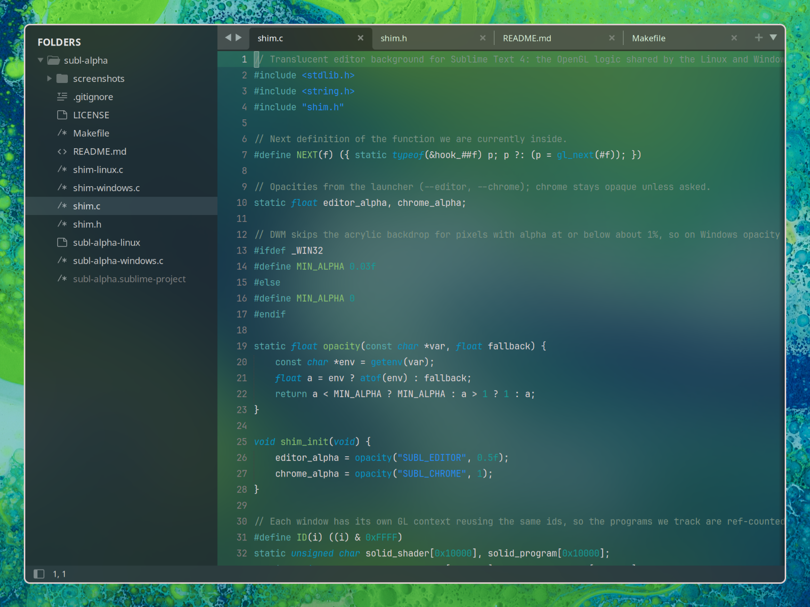

# subl-alpha

Makes the background of Sublime Text 4 see-through on Linux and Windows. The text stays solid and sharp.



*Sublime Text 4 on Arch Linux with Hyprland: editor 50% opaque, chrome 85% opaque.*

On Linux it needs a desktop with a compositor (Wayland or X11) and Sublime Text 4 installed at `/usr/bin/subl`. On Windows it needs Sublime Text 4 installed at `C:\Program Files\Sublime Text`. Installed somewhere else? Set the `SUBL` environment variable to the `subl` (Linux) or `sublime_text.exe` (Windows) path.

Tested on Linux with builds 4143, 4192 and 4215. Windows is untested. A Sublime update that changes its shaders or OpenGL calls can break it.

## 📦 Install

### 🐧 Linux

You need `gcc`, `make` and the OpenGL headers: `libglvnd` (Arch), `libgl-dev` (Debian/Ubuntu) or `mesa-libGL-devel` (Fedora).

```sh
make
```

### 🪟 Windows

Download `subl-alpha-windows.zip` from the [latest release](https://github.com/turtlehat/subl-alpha/releases/latest) and unzip it. There's nothing to build.

Or build it yourself with [Zig](https://ziglang.org/download/):

```powershell
zig cc -O2 -shared -o shim.dll shim.c shim-windows.c -lopengl32 -lgdi32 -luser32
zig cc -O2 -Wl,--subsystem,windows -municode -o subl-alpha-windows.exe subl-alpha-windows.c
```

## 🚀 Use

Add the opacities to your Sublime preferences (Preferences > Settings), each once. Both go from 0 (clear) to 1 (solid) and default to solid:

```json
"editor_opacity": 0.5,
"chrome_opacity": 0.8,
```

- `editor_opacity`: the editor background.
- `chrome_opacity`: the tab bar, sidebar and status bar.

Close all Sublime windows, then start it with `./subl-alpha-linux` (Linux) or `.\subl-alpha-windows.exe` (Windows). Changes to the preferences apply while Sublime is running.

On Windows the see-through areas are blurred and never fully clear.

Not covered: popups, panels and the GTK menu bar stay opaque, and portable, Snap and Flatpak installs aren't supported.

## 🔍 What it does

The launcher starts Sublime with `shim.so` (Linux) or `shim.dll` (Windows) loaded into it. The shim only wraps the window and OpenGL calls Sublime already makes; Sublime's files are never modified. The only file it reads is your Sublime preferences, for the two opacity values.

- 🪟 **Window:** makes the window and its drawing surface see-through.
- 🔤 **Text:** keeps text solid and sharp.
- 🎨 **Editor and chrome:** fades the editor and chrome by your opacities. Popups stay solid. The code is in `shim.c`.

The Windows launcher injects `shim.dll` into Sublime, which some antivirus tools flag. The code is short, so read it before you run it. To remove it, delete the folder; nothing else is installed.

## 📄 License

MIT